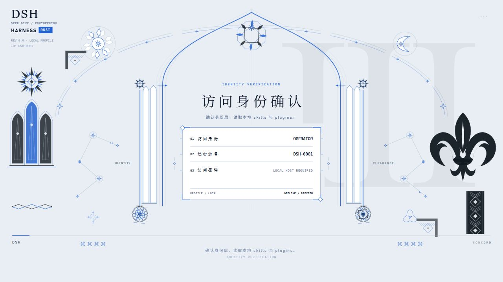
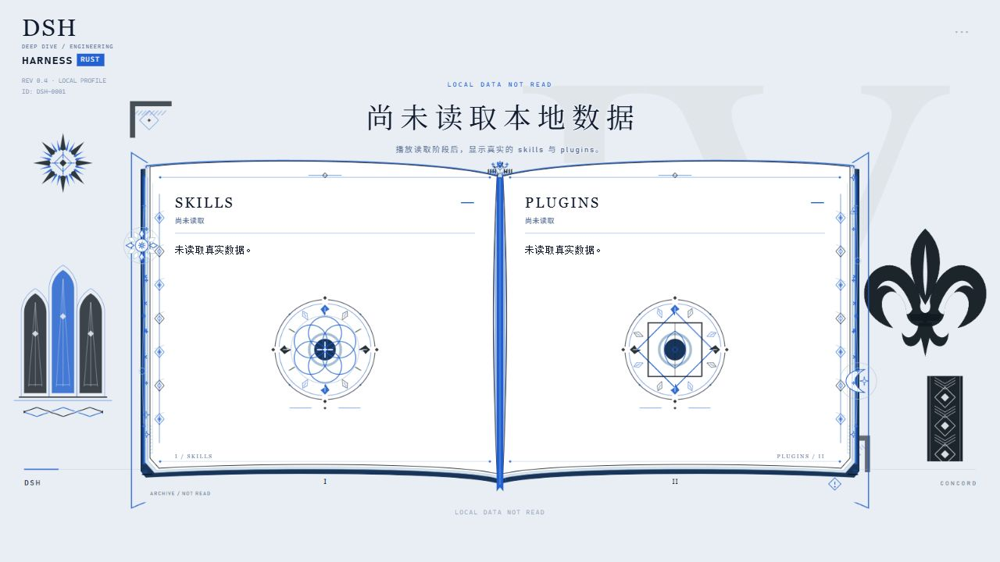

# LateranoUI · 拉特兰风 UI

以几何与神学意象构成的原创平面启动界面：教堂尖拱、直立鸢尾、纯白日轮、月牙与星链，从身份档案连续重组为一本能力书册。

本仓库从 [deepseek-harness-rust-optimize](https://github.com/Ar1haraNaN7mI/deepseek-harness-rust-optimize) 的 [`16dbd2d`](https://github.com/Ar1haraNaN7mI/deepseek-harness-rust-optimize/commit/16dbd2d) 抽离，**仅提供拉特兰风高清 UI 与官方 DSH 的可选网页启动插件**。图形通过原生 Canvas / SVG 绘制，文字与表单使用 HTML；不需要前端框架或动画库。这里不包含 Rust 模型引擎、独立桌面程序或 TUI，它们的安装方式见下文。





以上为 Rust 原项目中同一套高清资源的离线预览截图，展示界面构图；图中的未连接状态不代表已读取本机清单。

## 画面与交互

- 六幕围绕启动、工作区、操作员身份、真实能力读取、结果确认与欢迎展开；基础编排约 20.4 秒，交互、真实读取与旁白会延长停留。
- 上下展开、径向构建与环向落位交错出现。日轮白瓣分层旋转，月牙轻摆、伴星绕行，星链光点巡行；等待确认时仍有环境运动。
- 身份页的尖拱、窗棂、日月与印记沿连续路径收向书脊，再展开为页边、页扣与印章。左页为 Skills，右页为 Plugins；装饰避开实际标题、名称和来源，长清单可滚动。
- 浅色与深色配色、响应式比例、减少动态效果；暂停时环境运动也停止，减少动态效果时显示静态完成构图。
- 固定英文旁白统一称呼 **OPERATOR**，不朗读自定义姓名或逐项插件。播放时不调用系统 TTS、不下载模型；音频来源说明见 [素材与许可](THIRD_PARTY_NOTICES.md)。

| 操作 | 功能 |
| --- | --- |
| 点按画面 / `Enter` / `Space` | 开始或确认当前节点 |
| `C` | 打开设置，调整身份预览、明暗、声音和播放选项 |
| `P` | 暂停 / 继续，包括自主运动 |
| `R` | 重播 |
| `M` | 静音 / 恢复声音 |
| `Esc` | 跳过演出；已接入的访问验证仍然生效 |

## 1. 只看高清动画

需要 Python 3.9+ 和支持 Canvas、Web Audio 的现代浏览器。在本仓库根目录执行：

```bash
git clone https://github.com/Ar1haraNaN7mI/LateranoUI.git
cd LateranoUI
python scripts/preview.py
```

默认只打印地址，不自动打开浏览器。手动打开 `http://127.0.0.1:8780/startup-preview.html`，对应页面是 [`docs/startup-preview.html`](docs/startup-preview.html)。端口占用时可用 `python scripts/preview.py --port 8781`，或 `--port 0` 自动选择空闲端口，再打开实际输出的地址。保持预览服务运行，结束时按 `Ctrl+C`。使用 HTTP 服务打开页面，不要直接双击 HTML。

页面支持 `?theme=light`、`?theme=dark` 和 `?motion=reduce`；例如在输出地址后添加 `?theme=dark&motion=reduce`。声音需首次点按后由浏览器允许播放。

**静态预览不会扫描电脑上的 Skills / Plugins，也没有真实账户或密码验证。** 页面明确显示离线状态，不能保存个人资料、把演出完成当作登录成功，或解锁任何工作台。连接本地宿主后，书页才显示该宿主返回的真实能力。

## 2. 官方 DeepSeek Harness：基础安装与动画插件

官方项目是 [deepseek-ai/deepseek-harness](https://github.com/deepseek-ai/deepseek-harness)，安装与使用资料见 [官方文档](https://deepseek-harness.github.io/deepseek-harness/) 和 [官方运行说明](https://github.com/deepseek-ai/deepseek-harness#run)。本插件固定适配 `@deepseek-ai/dsh@0.2.0-rc.2`；这是已验证版本，不代表上游最新版。

### 先运行官方原版

需要 Node.js **22.19+ 的 22.x 版本，或 24+**，以及 npm。在工作区运行：

```bash
npx @deepseek-ai/dsh@0.2.0-rc.2 web
```

默认打开 `http://127.0.0.1:3080`；使用 `web --no-open` 可仅启动服务。按官方页面完成登录和模型配置。此命令运行官方原版，不含 LateranoUI。

若要从官方源码运行，可按官方教程执行：

```bash
git clone https://github.com/deepseek-ai/deepseek-harness.git
cd deepseek-harness
pnpm install
pnpm run build
pnpm dsh web
```

源码主分支会随上游变化；独立插件仍使用自己的固定依赖，不会自动适配所有上游版本。

### 安装 LateranoUI 插件

回到 **LateranoUI 仓库根目录**，需要 Python 3.9+、上述 Node.js 与 npm：

```bash
python scripts/install_native_startup.py
```

安装器打包并全局安装 `@laterano-ui/native-startup`，自动安装其固定版本官方依赖；无需再单独全局安装官方 CLI。安装后从任意项目目录运行：

```bash
dsh-laterano startup profile --name OPERATOR --badge DSH-0001
dsh-laterano web --startup
```

`dsh-laterano` 是独立命令，现有 `dsh` 保留。动画覆盖在真实官方网页上，完成或跳过后返回官方工作台；中段读取当前默认 Agent 预设作用域的 Skills，以及实际运行中的主机和默认预设插件。这个读取过程不创建聊天会话、不执行模型任务或插件工具。

动画默认关闭，可选择本次、下次或长期启用：

```bash
dsh-laterano web --startup          # 本次播放
dsh-laterano web --no-startup       # 本次跳过
dsh-laterano startup next on        # 下次打开本机官方网页时播放
dsh-laterano startup next off       # 下次打开时跳过
dsh-laterano startup enabled on     # 长期启用
dsh-laterano startup enabled off    # 恢复默认关闭
dsh-laterano web --port 3081        # 官方网页参数继续传递
```

一次性选择在启动成功、首次打开通过官方登录的本机网页时消费；`--no-open` 会等到手动打开，帮助、配置导出和非 Web 命令不消费。显式本次开关优先，同时消费该次选择。同一标签页完成或跳过后，刷新不会重复播放。

配置独立存放于 `$DSH_HOME/laterano-ui`，未设置 `DSH_HOME` 时为 `~/.dsh/laterano-ui`。**此插件沿用官方登录，不新增 Rust 版的访问密码系统。** 支持官方 `web` / `--profile web` 的本机浏览器入口；不包含官方 Electron、远程部署、自定义原生预设或终端动画。

更新与卸载：

```bash
# 在 LateranoUI 源码目录更新并重新安装
git pull
python scripts/install_native_startup.py

# 卸载插件命令，保留原有 dsh 与用户资料
npm uninstall --global @laterano-ui/native-startup
```

可用 `python scripts/install_native_startup.py --pack-only` 在 `target/native-startup-package` 生成 `.tgz`，再通过 `npm install --global <文件路径>` 安装；首次仍需获取 npm 依赖，并非完整离线依赖包。`--prefix <目录>` 可指定隔离安装位置，需要自行将其命令目录加入 PATH。卸载后若不再需要偏好，可手动清理上述独立配置目录。

## 3. 第三方 Rust 版：CLI、网页与 Windows 桌面

若要使用终端演出、Rust 工作台和 Windows 原生窗口，请安装原项目 [deepseek-harness-rust-optimize](https://github.com/Ar1haraNaN7mI/deepseek-harness-rust-optimize)。这是第三方 Rust 实现，与上一节的官方 npm 版分别安装；本仓库的预览服务不会安装这些程序。

需要 **Rust / Cargo stable、Python 3.9+、Node.js 22.12+ 与 npm**。Windows 原生桌面另需 **Microsoft Edge WebView2 Runtime**；目前其他平台使用网页入口。首次安装：

```bash
git clone https://github.com/Ar1haraNaN7mI/deepseek-harness-rust-optimize.git
cd deepseek-harness-rust-optimize
python scripts/install_dsh.py
```

安装器编译 CLI 和网页资源，安装到 `CARGO_HOME`（默认 `~/.cargo`）。Windows 如提示 PATH 已更新，请重新打开终端；macOS / Linux 按安装器提示将安装目录的 `bin` 加入 PATH。之后切换到自己的项目目录：

```bash
dsh login                              # 保存模型凭据；实际对话前配置
dsh startup profile --visual-style laterano
dsh --startup                          # 终端动画，然后进入 TUI
dsh web --startup                      # 网页：高清动画 + 真实工作台
dsh app --startup                      # Windows 桌面：同一套高清动画
```

只看界面不需要模型 Key。网页与桌面共用 HTML / Canvas 高清动画；TUI 使用单独绘制的 Ratatui 点阵版本，按终端尺寸重排几何构图，读取启动时已加载的能力快照。终端不会增加密码输入。

```bash
dsh startup                            # 只预览终端演出，不创建会话
dsh startup --auto --silent             # 自动、静音终端预览
dsh startup web                        # 高清预览 + Rust 本机数据接口
dsh startup next on                     # 仅下次 TUI 交互启动播放
dsh startup next off                    # 仅下次 TUI 交互启动跳过
dsh --no-startup                        # 本次直接进入 TUI
dsh startup profile --visual-style rhine # 在原项目切回莱茵生命风
```

Rust 原项目保留两种风格；**LateranoUI 独立仓库只提供拉特兰风**。选择风格不会自动启用每次启动动画。网页和桌面的访问身份、档案编号、访问密码在进入后通过「设置 → 个人资料」修改；设置密码后，每次独立开屏或重播都需要本次验证。已有 Cookie、跳过按钮或进度控制不能替代验证。

Windows 可在安装时创建桌面快捷方式：

```powershell
python scripts/install_dsh.py --desktop-shortcut --desktop-workspace "D:\projects\demo"
```

更新时在 **Rust 原项目目录**执行 `git pull` 后重新运行 `python scripts/install_dsh.py`。`--root <目录>` 支持隔离安装；卸载对应 Cargo 安装中的程序可用 `cargo uninstall dsh-cli`，自定义安装根则用 `cargo uninstall --root <目录> dsh-cli`。网页资源位于安装根的 `share/dsh/web`，快捷方式与用户配置需要另行按需清理；不会因卸载程序自动删除聊天记录或凭据。完整说明以 [原项目 README](https://github.com/Ar1haraNaN7mI/deepseek-harness-rust-optimize#readme) 为准。

## 接入自己的网页

保持动画资源和数据接口同源，通过 iframe 嵌入；宿主负责真实资料、能力清单和访问校验。协议、生命周期与失败处理见 [接入说明](docs/INTEGRATION.md)。离线示范、已挂载能力快照和真实加载必须分别说明，不用动画计时伪造成功或百分比。

主要文件：

| 文件 | 内容 |
| --- | --- |
| `docs/startup-preview.html` / `.js` | 页面、交互与阶段编排 |
| `docs/startup-laterano.js` / `.css` | 几何构建、书页和排版 |
| `docs/startup-laterano-ornaments.js` | 日月星、两层绘制及迁移 |
| `docs/startup-local.js` | 真实本地资料与能力读取 |
| `docs/startup-embed.js` | 与宿主沟通完成、跳过和验证状态 |
| `docs/startup-text.js` / `startup-voice.js` | 文字演出与固定英文旁白 |

## 开发验证

修改后在本仓库根目录执行：

```bash
npm test
python scripts/test_bundle.py
```

前者检查动画、交互、文字、语音与原生适配器契约，后者核对分发资源与本机预览服务。最终仍建议通过 `python scripts/preview.py` 检查浅色、深色、窄窗口、暂停与减少动态效果；真实能力和访问验证则在相应 DSH 宿主中检查。

## 来源与许可

自绘徽章、几何图形与代码不是官方游戏素材，本项目与游戏及其发行方没有官方关联。设计研究参考 [几何与神学的碰撞](https://www.bilibili.com/video/BV17iGR6nEh9/) 和 [众生行记 UI／交互／动效记录](https://www.bilibili.com/video/BV1WFkwBJEhR/)；文字节奏参考 [RhineLabUI](https://github.com/LBEILC/RhineLabUI)，序列与确认机制参考 [dsh-startup-screen](https://github.com/6shenhonghong9/dsh-startup-screen)。

代码许可见 [LICENSE](LICENSE)；字体、参考实现与固定语音分别标注来源，详见 [THIRD_PARTY_NOTICES.md](THIRD_PARTY_NOTICES.md)，不将所有素材笼统归为同一种许可。
